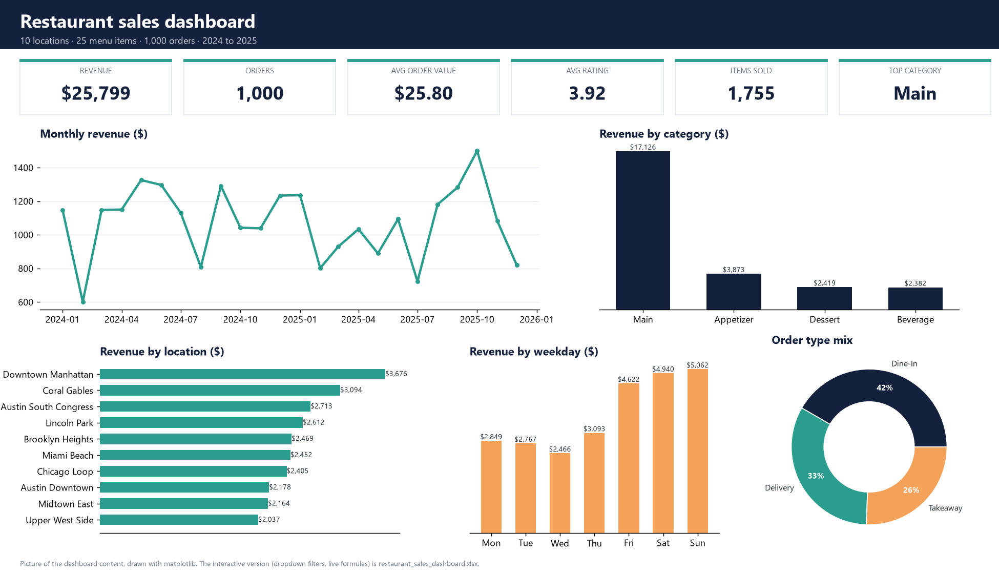

# Restaurant Sales: Interactive Excel Dashboard

> A formula-driven Excel dashboard (no macros, no pivot tables) with KPI cards, two dropdown filters and five native charts, built on 1,000 restaurant orders.

[Azərbaycanca](README.az.md) · **[Download the workbook](restaurant_sales_dashboard.xlsx)**



*The picture above shows the dashboard content, drawn with matplotlib. The interactive version is the Excel file.*

## What it does

- **Dashboard sheet:** KPI cards (revenue, orders, average order value, rating, items sold, top category), a **Location** and an **Order type** dropdown, and five charts: monthly revenue, revenue by category, by location, by weekday, and an order-type mix. Picking a value in a dropdown recalculates every KPI and chart.
- **Analysis sheet:** every number is a live `SUMIFS` / `COUNTIFS` / `AVERAGEIFS` formula over the data, so the logic is visible and auditable. The two dropdowns are turned into criteria in `B1:B2` (`*` means all).
- **Data sheet:** the 1,000 orders as an Excel table, plus `Month` and `Weekday` helper columns written as formulas (locale independent).
- **Notes sheet:** source, checks, how to use, limitations.

## Key insights

| Insight | Number |
|---|---|
| Revenue / orders / average order | $25,799 / 1,000 / $25.80 |
| Main courses carry the business | 66% of revenue from 47.5% of orders |
| Demand is concentrated on three days | Friday to Sunday: 57% of revenue, 58% of orders |
| Best location | Downtown Manhattan, $3,676 (14%) |
| Largest channel | Dine-in 42% of revenue; delivery and takeaway orders are about $1 larger ($26.27 vs $25.17) |
| Satisfaction | 71.5% of ratings are 4 or 5; average 3.92 |
| Top item | NY Strip Steak, $3,497 revenue, rating 4.09 |

## Checks

- Data checks before building (`src/prepare_data.py`): unique IDs, no blanks, `Order Total = Quantity x Unit Price` on every row, ratings 1 to 5, each menu item belongs to one category.
- Formulas were **recalculated independently** (Python `formulas` engine) and compared with pandas: all 121 numeric cells of the Analysis sheet match, and a filtered scenario (Miami Beach + Delivery) matches pandas too. I could not open the file in desktop Excel in this environment, so I have not seen it render there myself.

## Limitations

1,000 orders over two years is about 1.4 orders per day for 10 restaurants, so this is a sample; month-to-month swings are small-number noise. The ranking in "revenue by location" and "top 10 items" is fixed to the full data set and does not re-sort when a filter is applied.

## Rebuild

```bash
pip install -r requirements.txt
python src/prepare_data.py "path/to/04 Restaurant Sales.xlsx"   # data/restaurant_sales.csv is included
python src/build_workbook.py                                    # writes restaurant_sales_dashboard.xlsx
python src/make_preview.py                                      # writes images/dashboard_preview.png
```

## Author

**Alyaz Cabbarova**, aspiring data analyst, Baku.
[LinkedIn](https://www.linkedin.com/in/alyaz-cabbarova-450a6140b) · alyazcbbrv@gmail.com · [GitHub](https://github.com/alyazcbbrv-byte)

MIT License.
